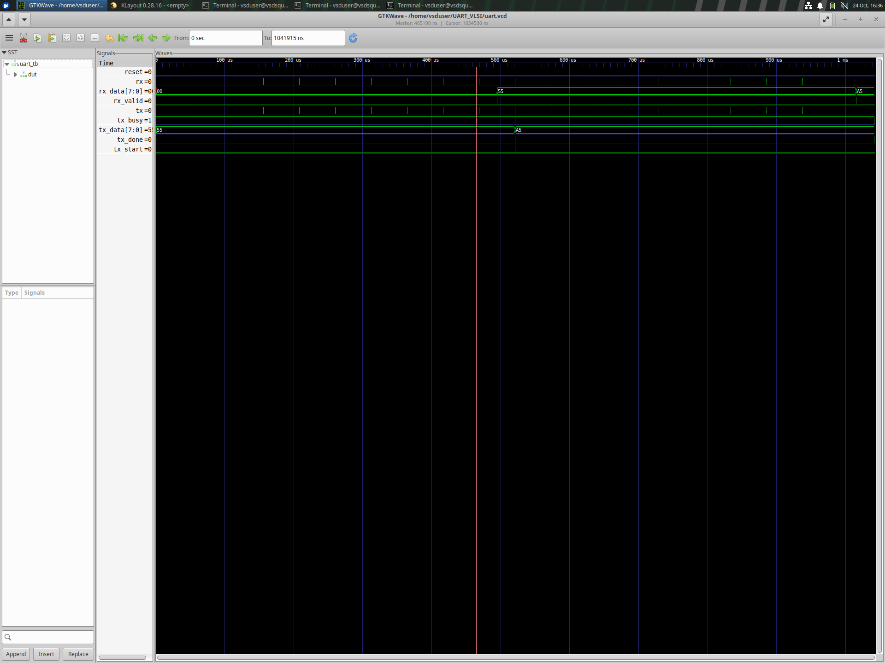
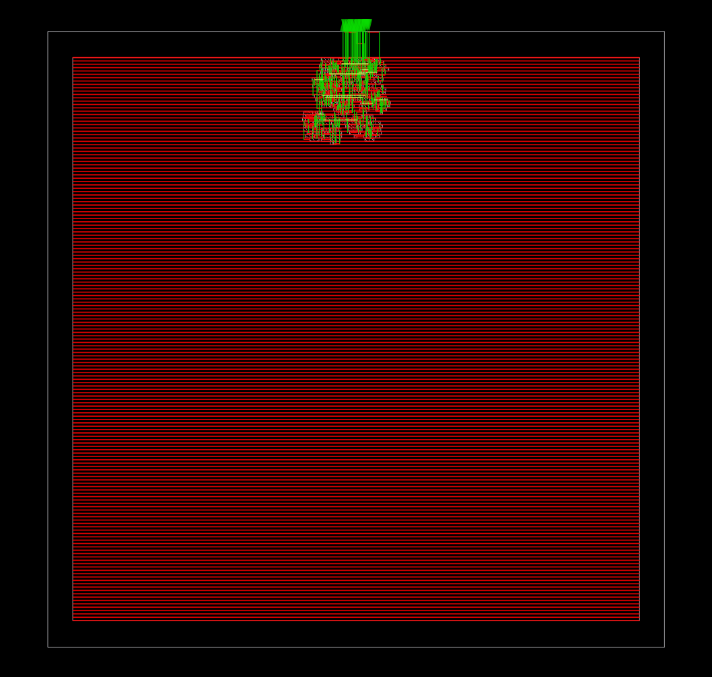

# UART Controller: RTL to Routed Layout on SkyWater sky130hd

### UART transmitter and receiver implemented with open-source tools (Yosys, OpenROAD, OpenSTA)

| | |
|---|---|
| **Name** | D.Pranithkumar, YOUR ROLL NUMBER |
| **Technology** | SkyWater sky130, `sky130_fd_sc_hd` |
| **Top module** | `uart_top` |
| **Flow** | RTL, simulation, synthesis, floorplan, placement, CTS, PDN, timing repair, global and detailed routing, multi-corner STA |
| **Final status** | Routed with 0 DRC violations; setup and hold positive at SS, TT and FF; RTL and gate-level simulation pass |

## 1. Design specification

| Item | Value |
|---|---|
| Top module | `uart_top` |
| Inputs | `clk`, `reset`, `tx_start`, `tx_data[7:0]`, `rx` |
| Outputs | `tx`, `tx_busy`, `tx_done`, `rx_data[7:0]`, `rx_valid` |
| Baud parameter | `CLKS_PER_BIT = 5208` |
| Clock constraint | 10 ns period, 0.2 ns uncertainty (`constraints/uart.sdc`) |
| Final RTL | `uart_top.v`, `uart_tx_C_experiment.v`, `uart_rx_split_experiment.v` |

## 2. Tools

| Tool | Purpose |
|---|---|
| Icarus Verilog, GTKWave | RTL and gate-level simulation, waveforms |
| Yosys with ABC | Synthesis and sky130 technology mapping |
| OpenROAD | Floorplan, placement, CTS, PDN, timing repair, routing |
| OpenSTA (inside OpenROAD) | Multi-corner static timing analysis |
| SkyWater sky130 PDK, `sky130_fd_sc_hd` | Technology files and standard cells |

## 3. Functional simulation

The loopback testbench `tb/uart_tb.v` sends 0x55 and 0xA5 and checks that the receiver returns the same bytes.

| Simulation | Result |
|---|---|
| RTL (final RTL files) | TEST 1 and TEST 2 PASSED (`results/rtl_sim.log`) |
| Gate level (`synthesis/uart_C_D7000_mapped.v`, PDK functional models) | Both PASSED (`results/gate_level_sim.log`) |

The testbench is a two-byte check, not exhaustive verification.



## 4. Synthesis

Yosys with ABC mapped the RTL to `sky130_fd_sc_hd` cells with a delay target of 7000 ps (`synthesis/run_synthesis_C_D7000.tcl`, `synthesis/abc_timing.constr`). The TX bit-select was restructured to shorten the critical path. The pre-layout SS setup slack was +0.70 ns with no parasitics. This figure is superseded by the routed results below.

## 5. Physical design (OpenROAD)

Flow order:

1. Floorplan, pin placement and global and detailed placement (`floorplan_C.tcl`)
2. Clock tree synthesis (`cts_C.tcl`)
3. Power distribution network and via repair, run on the CTS database (`pdn_C.tcl`, `repair_pdn_C.tcl`)
4. Timing repair at the SS corner with a propagated clock, then legalization (`repair_D.tcl`): 1 setup buffer and 7 hold buffers
5. Global route and detailed route (`global_route_C.tcl`, `detailed_route_C.tcl`)
6. STA at SS, TT and FF with a propagated clock (`sta_route_*_C.tcl`)

## 6. Final results

Routed design: DRC violations = **0**.

| Corner | Setup slack (ns) | Hold slack (ns) |
|---|---|---|
| SS (-40C, 1.28 V) | +0.27 | +0.12 |
| TT (25C, 1.80 V) | +7.74 | +0.22 |
| FF (-40C, 1.65 V) | +7.80 | +0.15 |

Raw numbers: `results/sta_summary_D.txt`. Logs and reports: `physical_design/`.



Basis and limits:

- STA uses a propagated clock and `estimate_parasitics -placement`. It does not use extracted routed RC, so this is not signoff.
- SS hold margin is small (+0.12 ns) and relies on 7 input hold buffers.
- `lpflow_*` cells from synthesis remain in the netlist. They were excluded only from new repair choices.
- Not done: GDSII export, DRC and LVS in KLayout, parasitic extraction, power analysis.

## 7. Problems faced and solutions

- **First routed flow had no clock tree.** The PDN step started from the floorplan database instead of the CTS database, so the routed STA numbers were invalid (they matched the pre-CTS numbers exactly). Fixed by running CTS, then PDN, then repair, then route.
- **SS setup was -0.62 ns after place and route.** The critical path went through weak cells driving high fanout, including `lpflow` cells. `repair_timing` at the SS corner added one buffer and gave +0.27 ns.
- **SS hold violated by -0.75 ns once the clock was propagated.** The failing paths were input ports. The SDC treats the external clock as ideal while the internal clock tree has about 1.76 ns insertion delay. Hold repair at SS added 7 delay buffers.
- **Gate-level simulation timed out with all-X outputs.** The wrong functional model set (power-pin variants) was used. Using the PDK `primitives.v` and `sky130_fd_sc_hd.v` with `-DFUNCTIONAL -DUNIT_DELAY='#0'` fixed it.

## 8. Repository layout

```
.
├── README.md
├── REPRODUCE.md
├── PROJECT_SUMMARY.txt
├── rtl/                 final RTL
├── tb/                  testbench
├── constraints/         SDC
├── synthesis/           synthesis script, ABC constraints, mapped netlist
├── physical_design/     OpenROAD scripts, logs, DRC report, routed DEF
├── results/             STA summary, simulation logs, FINAL_RESULTS.md
└── images/              screenshots
```

## 9. How to reproduce

See `REPRODUCE.md` for simulation commands and the physical flow order.


## 10. Conclusion and future work

The UART design completed synthesis, placement, CTS, timing repair and routing on sky130hd, with a DRC-clean routed layout and positive setup and hold at three corners. Future work: extracted-RC timing with OpenRCX, GDSII with DRC and LVS, a longer testbench, and a single script for the whole flow.

D.Pranithkumar, 24EG104B62


## Project Video
https://drive.google.com/file/d/1mNw7v-a51yZ-grDotlNMWSaQnmH26f4D/view?usp=drivesdk
